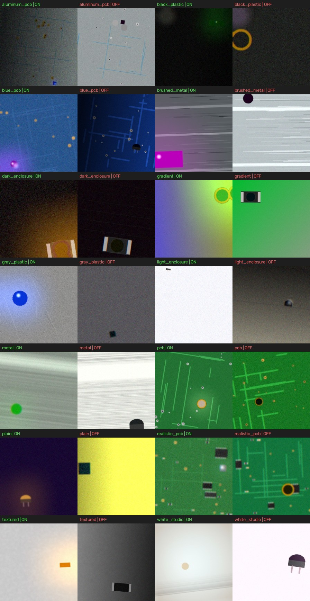
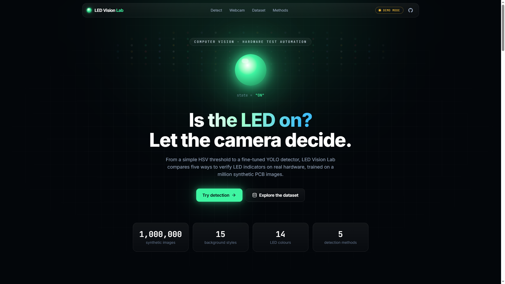
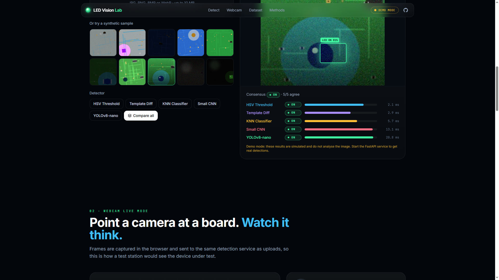

# LED Vision Lab

A computer vision platform that detects whether an LED is **ON** or **OFF** from an image, comparing multiple detection approaches to find the best trade-off for different environments.

## Problem

In hardware testing and manufacturing, engineers need to automatically verify visual indicators (LEDs):

```
Test System → Send command to DUT → LED should turn ON
→ Camera captures image → Vision system detects state → PASS / FAIL
```

## Detection Methods

| Method | Type | Training Required |
|--------|------|:-----------------:|
| HSV / Color Detection | Classical CV | No |
| Template / Image Difference | Classical CV | No |
| KNN Classifier | Traditional ML | Yes |
| Small CNN | Deep Learning | Yes |

All methods expose the same interface and are evaluated on the same benchmark dataset.

## Project Structure

```
led-vision-lab/
├── src/led_vision/       # Core Python package
│   ├── detectors/        # HSV, Template, KNN, CNN detectors
│   ├── preprocessing/    # Image loading and ROI extraction
│   ├── features/         # Feature extraction for ML detectors
│   ├── synthetic/        # Synthetic dataset generator
│   ├── training/         # KNN and CNN training pipelines
│   ├── benchmark/        # Benchmark runner
│   └── api/              # FastAPI REST API
├── configs/              # YAML configuration files
├── data/                 # Sample images (generated data is gitignored)
├── artifacts/            # Trained models and benchmark results
├── notebooks/            # Google Colab notebooks (dataset, HSV baseline)
├── tests/                # Unit, integration, and API tests
├── scripts/              # Utility scripts
└── web/                  # Web application (Phase 9)
```

## Setup

### Requirements

- Python 3.11+
- [uv](https://docs.astral.sh/uv/) (package manager)

### Install uv

```powershell
powershell -ExecutionPolicy ByPass -c "irm https://astral.sh/uv/install.ps1 | iex"
```

### Create environment and install dependencies

```bash
uv sync --extra dev
```

### Activate virtual environment

```powershell
# Windows
.venv\Scripts\activate
```

```bash
# macOS / Linux
source .venv/bin/activate
```

## Running Tests

```bash
pytest
```

## Synthetic Dataset

LED images are generated procedurally: 14 LED colors, 6 shapes (round, square, rectangular, dome, side-view dome, SMD), 15 background styles, ambient lighting, glare, occlusion, camera noise/blur, false-positive distractors, and four difficulty levels. Every image has a 40-field metadata row (`metadata.csv`) and every run is reproducible from its seed.



| Config | Scenes | Export sizes (px) | Images | Focus |
|--------|-------:|-------------------|-------:|-------|
| `configs/dataset/default.yaml` | 100 | 64, 128, 224, 256 | 400 | Quick smoke run |
| `configs/dataset/pcb_20k.yaml` | 20,000 | 128, 224 | 40,000 | Evaluation / Colab set, same mix as `pcb_1m` |
| `configs/dataset/large_scale.yaml` | 50,000 | 64, 128, 224, 256 | 200,000 | General mix |
| `configs/dataset/pcb_1m.yaml` | 250,000 | 64, 128, 224, 256 | 1,000,000 | ~65 % PCB backgrounds |
| `configs/dataset/high_res.yaml` | 10,000 | 512, 1024, 2048 | 30,000 | High-resolution |

Generated datasets are not committed. Small samples live in [`data/samples/images`](data/samples/images).

```bash
uv run python scripts/generate_dataset.py --config configs/dataset/pcb_20k.yaml
uv run python scripts/make_samples.py --dataset data/generated_20k --size 224   # refresh samples + grid
```

## Where the numbers come from

Every statistic shown in the UI or served by the API is computed by a script and stored as JSON with its provenance (timestamp, git commit, machine, Python version):

| Numbers | Produced by | Stored in |
|---------|-------------|-----------|
| Dataset composition (scenes, ON/OFF, splits, backgrounds, difficulty) | `scripts/compute_dataset_stats.py --dataset data/generated_20k` — counts `metadata.csv` | `artifacts/dataset/stats.json` |
| Detector accuracy, F1, false ON/OFF, latency, per-difficulty and per-surface breakdowns | `scripts/run_benchmark.py --dataset data/generated_20k --split test` | `artifacts/benchmarks/summary.json` |
| HSV thresholds | `scripts/calibrate_hsv.py --dataset data/generated_20k` — grid search on the **train** split only | `configs/detectors/hsv.yaml` |
| Error analysis grids | `scripts/error_gallery.py --dataset data/generated_20k --split val` | `artifacts/benchmarks/errors_*.jpg` |

The test split is never used for calibration or training. The two JSON reports are committed, so the UI shows measured numbers even without the API.

## Notebooks (Google Colab)

Each notebook clones the repo, generates the 20K dataset from the same seed (a few minutes on Colab's CPU), and rebuilds the numbers above step by step, checking them against the committed reports.

| Notebook | Covers | |
|----------|--------|---|
| [`01_dataset.ipynb`](notebooks/01_dataset.ipynb) | Generation, composition, ON/OFF balance per difficulty, reproducibility check, sample grid | [](https://colab.research.google.com/github/barak2rozenfeld/led-vision-lab/blob/master/notebooks/01_dataset.ipynb) |
| [`02_hsv_baseline.ipynb`](notebooks/02_hsv_baseline.ipynb) | HSV algorithm with intermediate maps, train-split calibration, test benchmark, error analysis | [](https://colab.research.google.com/github/barak2rozenfeld/led-vision-lab/blob/master/notebooks/02_hsv_baseline.ipynb) |

To run them locally:

```bash
uv sync --extra dev --extra notebooks
uv run jupyter nbconvert --to notebook --execute --inplace notebooks/01_dataset.ipynb
```

## Web UI

A React single-page app in [`web/`](web) with five sections: hero, live detection (upload or pick a sample, run one detector or all five), webcam live mode, dataset explorer, and a method comparison board.




```bash
cd web
npm install
npm run dev        # http://127.0.0.1:5173
```

The UI talks only to the REST API, proxied to `http://127.0.0.1:8000`; set `LED_API_URL` to point elsewhere. When the API is not reachable it switches to **Demo mode**: detections are simulated, do not look at the image, and are labelled as such. Dataset and benchmark panels always show measured numbers (live from the API, or the committed snapshot) with a "where these numbers come from" note.

## Running the API

From the repository root:

```bash
uv run uvicorn led_vision.api.app:create_default_app --factory --port 8000
```

Interactive docs: <http://127.0.0.1:8000/docs>. Settings (upload limits, accepted types, artifact paths) are in `configs/api.yaml`.

```bash
curl -F "image=@data/samples/images/<file>.jpg" -F "method=hsv" http://127.0.0.1:8000/api/v1/detect
```

## API Endpoints

| Method | Endpoint | Description |
|--------|----------|-------------|
| GET | `/api/v1/health` | Health check and ready methods |
| GET | `/api/v1/methods` | All methods with status: `ready`, `not_trained`, `planned` |
| POST | `/api/v1/detect` | Multipart `image` + `method` (default `hsv`) → `DetectionResult` |
| POST | `/api/v1/compare` | Multipart `image` → results of every ready method |
| GET | `/api/v1/dataset/stats` | Dataset composition report |
| GET | `/api/v1/benchmark` | Latest benchmark report |

Errors are JSON `{"detail": "..."}`: 415 unsupported type, 413 too large, 400 corrupt image, 404 unknown method or missing report, 503 method not trained yet.

## Core Research Question

> What is the simplest, fastest, and most reliable method for detecting whether an LED is ON or OFF under different visual conditions?

## Documentation

- [`Goal.md`](Goal.md) — Project vision and objectives
- [`Roadmap.md`](Roadmap.md) — Development phases
- [`Architecture.md`](Architecture.md) — System design
- [`CONTRIBUTING.md`](CONTRIBUTING.md) — Contribution guidelines
